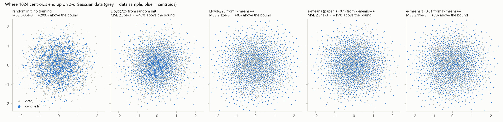
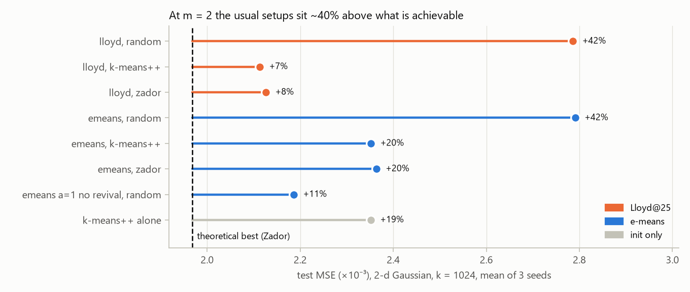
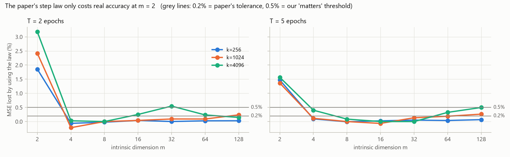
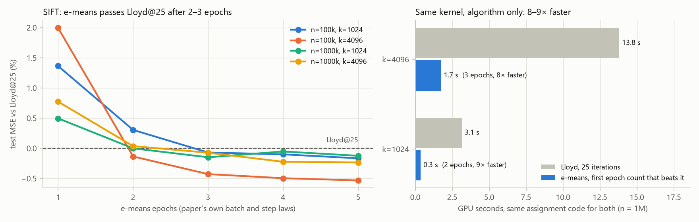
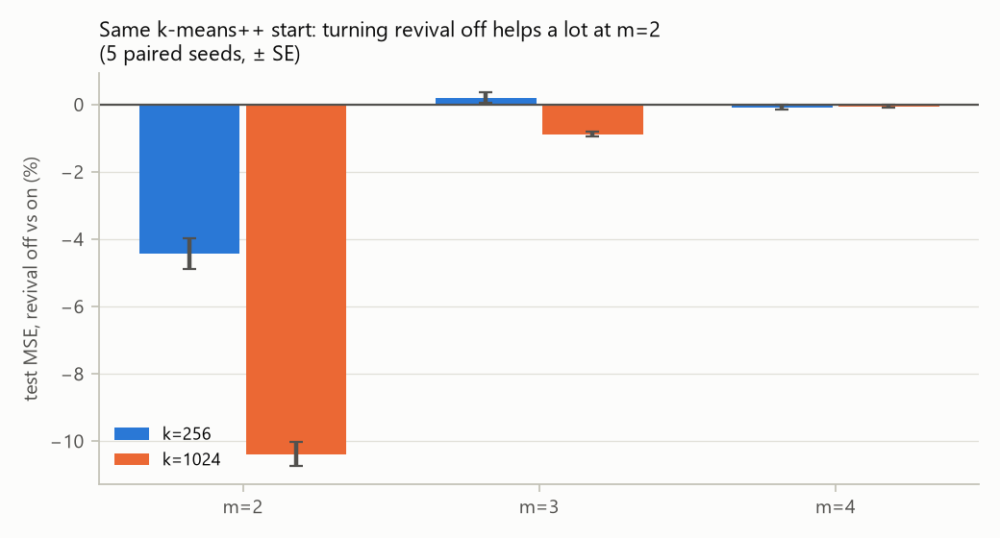
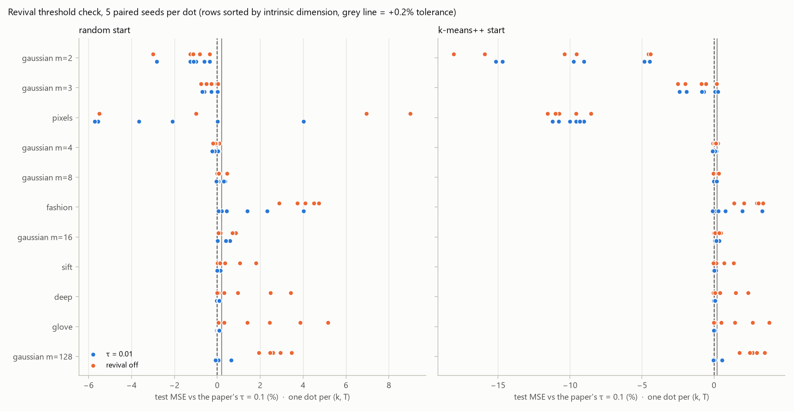
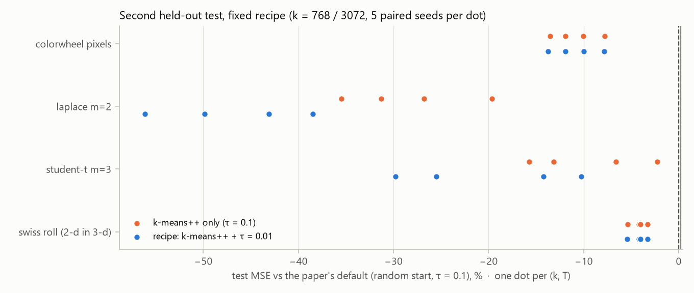

# e-means at low intrinsic dimension

Personal research project, Leiden 2026.

The project looks at e-means ([paper](https://arxiv.org/abs/2611.09501), Bessa et al., Nov 2026). e-means is basically mini-batch k-means where the centroids are updated with an exponential moving average. The step size and batch size come from two scaling laws that the authors fitted on a single dataset (DEEP). In the paper they say the laws don't work well on very low-dimensional data and that the intrinsic dimension of the data is probably what's missing. I wanted to check if that's true.

Short version: it mostly isn't. The step-size law holds up fine. What actually goes wrong at low intrinsic dimension is the random starting centroids and the "revival" step that resets dead clusters. Using k-means++ and a lower revival threshold fixes most of it.

Below is what I found and how to run it.



---

## Results

1. Reproduction: on SIFT1M, e-means with the paper's settings beats Lloyd's k-means (25 iterations) after 2-3 epochs. With the same assignment code for both it's 8-9x faster, so that's the part of the paper's 10-45x speedup that comes from the algorithm itself.

2. The step-size law is fine once the intrinsic dimension is around 4 or higher. The regret (how much worse the law is than the best step I found) is mostly under 0.25% on synthetic data (max 0.55%) and under 0.18% on SIFT, DEEP, GloVe and Fashion-MNIST. There's no trend with dimension (slope -0.02, 95% CI [-0.46, 0.35]). So my original idea, that the step should depend on dimension, didn't hold up.

3. At intrinsic dimension 2 both Lloyd and e-means end up about 40% above the error you could get. This is because of the random start: picking data points as centroids gives a centroid density proportional to p, but quantization theory (Zador) says the best density is proportional to p^(1/2).
   - k-means++ fixes this for Lloyd.
   - e-means doesn't keep the good start. From the same k-means++ start it ends 11% worse than Lloyd, because revival keeps moving the small (but correct) clusters in the tails back to the middle. Turning revival off makes it 4-10% better (5/5 paired seeds).

4. Just lowering the revival threshold (τ = 0.01 instead of 0.1) doesn't work everywhere. It helps a lot at low dimension and does nothing on the big embedding datasets, but it's up to 4% worse when there are only a few points per cluster (Fashion-MNIST).

5. So I ended up with a simple rule: if the estimated intrinsic dimension is below 3.5, use k-means++ and τ = 0.01, otherwise use the paper's defaults.
   - First held-out test: -16% on average and never worse, but it still failed my criteria because the dimension estimate got one image wrong.
   - I fixed that by using at least 20 neighbours in the estimator (decided on data I had already used).
   - Second held-out test on completely new data: passed. All 14 datasets classified right, -20% on average, every setting better, and up to -56% on heavy-tailed data.
   - Most of the τ effect is on data where the density changes a lot (heavy tails). On roughly uniform data k-means++ does all the work.

---

## Figures

### Where the centroids end up (top of the page)

This is the picture that explains most of the project. It's 1024 centroids on 2-d Gaussian data, with the gap to the best possible error in each panel. With a random start the centroids stay too close to the centre (+40%). k-means++ spreads them out (+8%), but then the paper's e-means pulls them back in again (+19%). With a lower revival threshold they stay out (+7%).

### m = 2 against the theoretical bound



The same thing as numbers. The dashed line is the best error you can get according to Zador's formula, and every dot is how far a setup ends above it. Both methods from a random start are about 40% above it. k-means++ gets Lloyd down to +7%, but e-means from the same start is still +20%. e-means with α0 = 1 and revival off gets to +11% even from a random start, which was the first hint that revival is part of the problem.

### Regret of the step law



This was the original question. For every m I found the best step size and checked how much worse the paper's law is. It only really costs anything at m = 2. From m = 4 up it stays around the 0.2% line (worst 0.55%), and there's no trend with m.

### Reproduction on SIFT



Just to check my implementation behaves like the paper's. e-means catches up with Lloyd@25 after 2-3 epochs, and since both use the same assignment code the speedup here (8-9x) is only from the algorithm.

### Revival from a k-means++ start



Each bar is how much the test error changes when I turn revival off, starting e-means from the same k-means++ centroids. At m = 2 it's 4-10% better (5 paired seeds), at m = 3 and 4 it barely matters. That's how I found that revival was the problem and not the step size.

### τ = 0.01 on every dataset



So I tried just lowering the revival threshold everywhere. It's good at low dimension (about -4% on average) and does nothing on SIFT, DEEP and GloVe, but on Fashion-MNIST with k = 4096 it's +4% worse. So it can't be the default for everything, which is why the rule checks the dimension first.

### Second held-out test



The final test of the rule, on datasets I hadn't touched before (a colour wheel image, a swiss roll, Laplace and Student-t data). Every dot is one (k, T) setting averaged over 5 paired seeds. Orange is k-means++ alone, blue is k-means++ with τ = 0.01. Everything is left of zero, so the rule always helped. On the colour wheel and the swiss roll the two colours are on top of each other, so there it's all k-means++. On Laplace and Student-t the lower τ adds a lot on top. The first test (fig20) is the same kind of plot. That one failed because on the retina image with k = 2048 the dimension estimate came out at 3.54, just above the threshold. The image only has about 17.8k distinct colours, so it only got 9 neighbours, which is why I added the floor of 20.

The rest of the figures are in `figures/`.

---

## Background

e-means (paper section 3) keeps a moving-average count N_j and sum S_j for every cluster, and the centroid is S_j / N_j. On top of that:
- the step size follows a cosine schedule that starts at α0
- every few batches, clusters with a count below τ = 0.1 × the mean count get "revived" by splitting a big cluster
- batch size and α0 come from two power laws fitted only on DEEP

The paper says these laws are "not optimal on very low-dimensional and tiny datasets", so that's what I looked at.

---

## What I did

- Wrote e-means and Lloyd myself in PyTorch, using the same GPU assignment function for both so the speed comparison is fair.
- Made synthetic data where I control the intrinsic dimension m (Gaussian, uniform, Student-t, Laplace, plus some with noise). For real data I used SIFT, DEEP, GloVe and Fashion-MNIST from ann-benchmarks, and RGB pixels from the scikit-image example photos.
- For every setting I swept 15 step sizes around what the law predicts (half-octave steps, same seeds for each) to find the best one.
- Estimated intrinsic dimension with PCA, TwoNN and Levina-Bickel, including a version with K = n/k neighbours (roughly the size of one cluster).
- Before each of the main tests I wrote down what would count as pass or fail, and I report the result either way. A few of them failed. Each test script prints its criteria as PASS/FAIL.

All together it's about 10,000 short clustering runs on my laptop GPU (RTX 3060, 6 GB).

---

## Limitations

- Mostly n ≤ 10^6 points and k ≤ 4096. The paper goes up to 10^10 points and 16M clusters.
- I use FP32 for the assignment, not the paper's BF16/FP8 kernels. The link to their library in the PDF is cut off, so I couldn't compare with their code and my version might differ in small details.
- The low-dimension effects are clearest on synthetic data. Pixels are the only real low-dimensional dataset I have, and they're noisy.
- The dimension rule first broke on image data with lots of duplicate colours (too few neighbours). The K-floor fix passed a new test, but only on a handful of datasets and with one threshold (3.5).
- Most real-data numbers are from 3-5 seeds.

---

## Setup

Python 3 with a CUDA GPU. Install torch with CUDA first and then the rest:

```
python -m venv .venv
.\.venv\Scripts\python -m pip install torch==2.14.1 --index-url https://download.pytorch.org/whl/cu130
.\.venv\Scripts\python -m pip install -r requirements.txt
.\.venv\Scripts\python -m pytest -q
```

All 17 tests should pass.

## Getting the data

The real datasets are the ann-benchmarks HDF5 files: `sift-128-euclidean` (~525 MB), `fashion-mnist-784-euclidean` (~230 MB), `glove-100-angular` (~485 MB) and `deep-image-96-angular` (~3.8 GB). Put them in `~/emeans_data`, or set `EMEANS_DATA` to wherever they are. I keep them outside the repo folder on purpose because it's synced by OneDrive and the files are way too big for GitHub.

The downloads kept dropping for me every few MB, so use curl with resume and just run it again until it finishes:

```
curl.exe -L -C - -o sift-128-euclidean.hdf5 http://ann-benchmarks.com/sift-128-euclidean.hdf5
```

run_block.py checks the file size, so a half-downloaded file just gets skipped there. The pixel data comes with scikit-image, nothing to download.

## How to run

Every sweep appends to a csv in `results/` (gitignored), so if it crashes or you stop it, it picks up where it left off. All of them together take a few hours on a laptop GPU. The big real-data ones need a few GB of free RAM, so close Chrome first if it's tight.

```
.\.venv\Scripts\python experiments\sanity_checks.py all     # reproduction + sanity checks (S4b-S7)
.\.venv\Scripts\python experiments\run_block.py B           # main sweep (also B_norev, Bp, C_*, D, E, F)
.\.venv\Scripts\python experiments\analyze.py B             # alpha*, regret, slope with cluster bootstrap
.\.venv\Scripts\python experiments\kpp_check.py             # starting points at low m
.\.venv\Scripts\python experiments\tau_confirm.py           # revival threshold check
.\.venv\Scripts\python experiments\rule_test.py             # first held-out test of the rule
.\.venv\Scripts\python experiments\kfloor_design.py         # checking the K-floor fix (old data only)
.\.venv\Scripts\python experiments\rule_test2.py            # second held-out test, fixed rule, new data
.\.venv\Scripts\python experiments\all_figures.py           # figures 1-18
```

rule_test.py and rule_test2.py take `--analyze` to skip the runs and just redo the numbers and the figure from the csv.

---

## Layout

```
emeans_id/     e-means, Lloyd, k-means++, scaling laws, synthetic + real data, ID estimators
experiments/   one script per experiment, plus analysis and figures
tests/         unit tests
results/       csv output (not in git)
figures/       all figures
```

---

## References

- S. Bessa et al. *e-means: outperforming k-means (in one-tenth the epochs).* arXiv:2611.09501, 2026.
- P. Zador. *Asymptotic quantization error of continuous signals and the quantization dimension.* IEEE Trans. Inf. Theory 28(2), 1982.
- E. Levina, P. Bickel. *Maximum likelihood estimation of intrinsic dimension.* NeurIPS 2004.
- E. Facco et al. *Estimating the intrinsic dimension of datasets by a minimal neighborhood information.* Scientific Reports 7, 2017.
- D. Arthur, S. Vassilvitskii. *k-means++: the advantages of careful seeding.* SODA 2007.
- M. Aumüller et al. *ANN-Benchmarks.* Information Systems 87, 2020.
